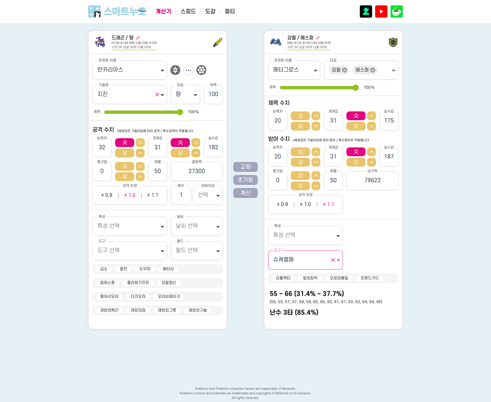
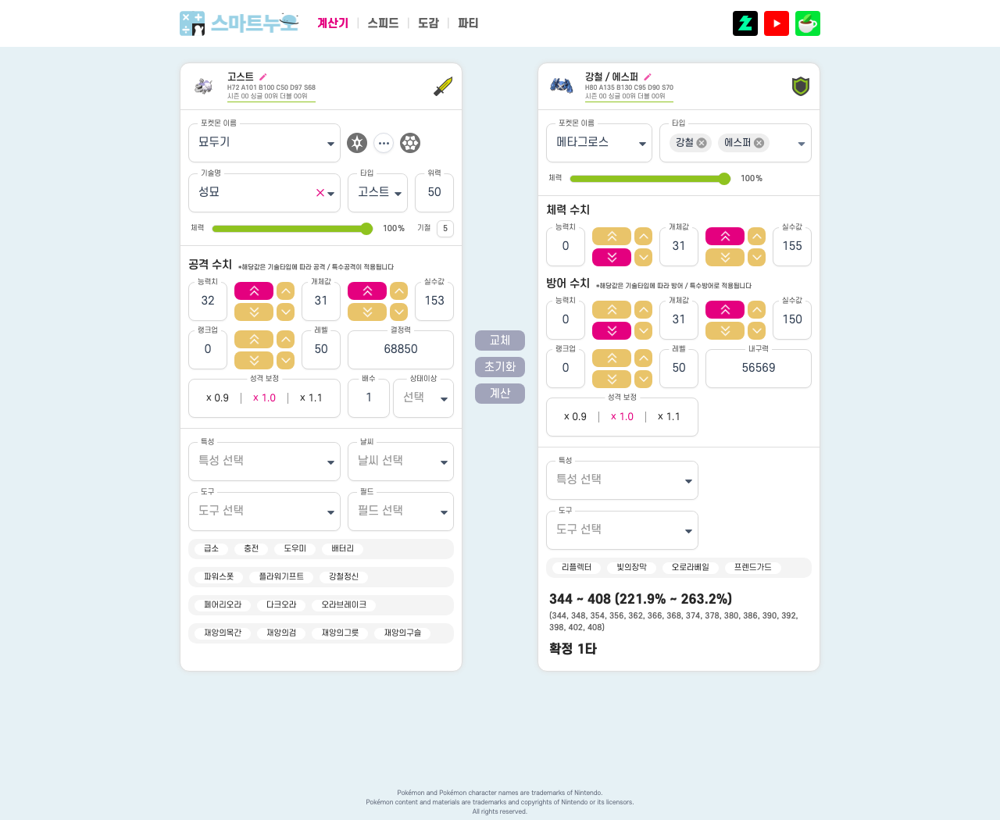

# 스마트누오 조건부 계산 비교

- 확인일: 2026-11-18, Asia/Seoul.
- 상태: `DONE_WITH_CONCERNS`. 비교·기록·한글명 정리는 완료했고, 미판정 시퀀스와 검증 한계는 아래에 남겼다.
- 대상: [데미지 계산기](https://smartnuo.com/), [스피드 계산기](https://smartnuo.com/speed).
- 범위: 이 저장소의 고정 챔피언스 카탈로그에 있는 포켓몬·폼·특성·기술만 계산에 사용했다. 기술은 해당 포켓몬의 `moveIds`에 있는지 먼저 확인했다. 도구 사례에는 챔피언스 엔진 목록에 있는 생명의구슬·슈캐열매를 사용했다.
- 증거: [관찰 데이터](smartnuo-comparison.json), [성묘 입력 화면](smartnuo-evidence/last-respects-100.png), [반감열매 결과 화면](smartnuo-evidence/resist-berry.png).

## 해석 기준

82건은 정상 계산, 입력 경계, 검색 실패를 포함한 UI 관찰 수다. 82개의 독립된 계산 규칙을 증명했다는 뜻이 아니다. 스크린샷 재현은 이 수에 중복 집계하지 않았다.

`목록에 있음`, `조건을 입력할 수 있음`, `선택 후 결과가 변함`, `사용 후 상태를 반복 KO에 반영함`을 구분했다. 위력·배수 수동 수정은 전용 조건 처리와 구분했다. 숫자 대조는 선택이 완료된 상태의 결과로 한정했다.

비교 당시 우리 앱은 싱글 지진 임시 검증 화면 단계였다. 아래의 확대 지원은 **설계상 합의·제안**이며 구현 완료 기능으로 집계하지 않는다. 스마트누오와의 차이를 현재 제품의 완성된 우위로 표현하지 않는다.

## 선택 목록 대조

| 대상      | 우리 카탈로그 | 확인 결과                                                                                                               |
| --------- | ------------: | ----------------------------------------------------------------------------------------------------------------------- |
| 기술      |           515 | 공개 `/api/move` 데이터에 515개 모두 있음. 데이터 미등재 0개. UI에서 515개를 모두 선택하거나 각 계산을 검증한 것은 아님 |
| 특성      |           216 | 데미지 선택 목록에서 63개, 스피드 목록까지 합치면 70개 연결. 나머지는 아래 원시 목록에서 구분                           |
| 포켓몬·폼 |           382 | 이름·엔진 별칭을 연결하면 377개 대응. 대응하지 않는 폼 이름 5개                                                         |

비교 사이트의 미대응 폼은 `mimikyubusted`, `polteageistantique`, `sinistchamasterpiece`, `vivillonfancy`, `vivillonpokeball`이다. 뒤의 네 개는 외형·진품 구분으로 일반 폼과 계산상 차이가 없는 경우를 별도로 확인해야 하므로 데미지 기능 누락 4개로 세지 않는다. 따라큐의 탈이 깨진 상태는 탈 처리 대상이다. 2026-11-19에 이 5개 폼의 공식 한글 이름·폼 표기를 확인해 별도 `nameKo`로 보완했으며, 포켓몬·폼 382개 모두 한글 표시명으로 연결했다. 당시 사이트의 `siteName: null`과 미대응 판정은 관찰 기록으로 보존한다.

미등재 특성 전체는 `smartnuo-comparison.json`의 `abilityCatalog`에 공격·방어·스피드 선택지별로 기록했다. 데미지·스피드와 무관한 특성의 제외는 기능 누락으로 간주하지 않는다. 곡예·속보는 데미지 목록에 없지만 **스피드 계산기에서 지원**한다.

데미지 계산에 영향을 줄 수 있으면서 해당 선택 목록에서 찾지 못한 예는 **탈·옹골참·틀깨기·긴장감·매지션·나쁜손버릇**이다. 기합의띠·옹골참의 HP 1 생존 처리는 구현 범위에 포함하며 구현 전이다. 도구 이동 효과는 우리 계산 범위에서 제외한다. 매지션·나쁜손버릇은 이 효과의 지원 차별점으로 집계하지 않는다.

## 기준 사례

한카리아스의 지진, 공격 포인트 32·공격 성격 보정 1.0 → 메가메타그로스의 HP 포인트 20·방어 포인트 20·방어 성격 보정 1.1. 레벨 50, 개체값 31, 랭크 0, 날씨·필드·벽·유효 특성·도구 보정 없음이다.

공격 182, 방어 209, HP 175에서 `102~120 (58.3~68.6%)`, `102, 102, 102, 104, 104, 108, 108, 108, 110, 110, 114, 114, 114, 116, 116, 120`, 확정 2타를 확인했다. 기존 검증 기대값과 일치한다.

## 조건별 관찰

| 기술·특성               | 스마트누오에서 확인한 동작                                                                                               | 우리 쪽 범위·상태                                                                                        |
| ----------------------- | ------------------------------------------------------------------------------------------------------------------------ | -------------------------------------------------------------------------------------------------------- |
| 성묘                    | 횟수 기본 0, 상한 5. 1회 `116~138`, 5회 `344~408`. 6·100을 입력해도 5회와 같은 결과이며 최종 입력도 5로 보정             | 최신 제품 입력 범위는 0~5회, 기본 0으로 제한. 원본 성묘의 기전상 상한 100과 구분. 엔진 보완·UI 미구현    |
| 분노의주먹              | 0회 `66~78`, 1회 `126~150`, 6회 `440~518`. 7회도 6회와 동일                                                              | 기본 0, 6회부터 효과 상한인 입력 설계. 엔진 보완·UI 미구현                                               |
| 토해내기                | 비축 횟수 입력을 찾지 못함. 기본 `0~0`. 위력을 직접 100으로 바꾸면 `25~30`                                               | 비축 0~3, 0회는 사용 불가 표시로 설계. UI·보완 미구현                                                    |
| 트리플악셀              | 기본 3회, 1회 `44~56`, 2회 `132~160`, 3회 `264~316`. 0·4 입력은 1·3으로 제한                                             | 최대 횟수 시작·기술별 제한 설계와 일치. 우리 전체 기술 UI 미구현                                         |
| 찍찍베기                | 기본 10회. 1회 `5~6`, 10회 `50~60`. 11은 10으로 제한                                                                     | 최대 횟수 시작·1~10 제한 설계와 일치                                                                     |
| 속임수                  | 상대 공격을 사용하며 왼쪽 공격 수치 영역에서 참조할 포인트·랭크를 입력. 포인트 0 `70~84`, 32 `85~102`, 32와 +2 `169~201` | 상대 개체의 공격 능력치·랭크를 자동 연결하는 설계. 엔진 자체 참조 지원 확인, 전체 UI 미구현              |
| 바디프레스              | 공격 수치 영역이 방어 기준으로 계산됨. 포인트 0 `26~31`, 32 `32~38`, 32와 +2 `63~75`                                     | 기존 능력치·랭크를 엔진에 전달할 대상                                                                    |
| 분함의발구르기·열불내기 | 직전 실패 전용 입력을 찾지 못함. 분함의발구르기는 기본 `104~126`, 위력 150 수동 입력 시 `206~246`                        | 기본 OFF의 강화 조건 토글 설계. ON 상태를 반복 공격에도 유지                                             |
| 변덕레이저              | 기본 위력 80에서 `36~42`. 160 수동 입력 시 `71~84`. 강화 분기 전용 선택은 찾지 못함                                      | 기본 OFF 강화 분기 토글 설계. 발동 확률을 데미지 난수와 합산하지 않음                                    |
| 객기·근성               | 무상태 `16~19`, 화상 `31~37`, 화상+근성 `46~55`로 변화                                                                   | 상태 토글과 특성을 같은 상태에 연결하는 설계                                                             |
| 병상첨병·베놈쇼크       | 방어 측 상태이상 입력을 찾지 못함. 병상첨병에서 공격 측 화상만 지정하면 `122~146`으로 그대로 유지                        | 기술에 필요한 대상의 상태를 ON/OFF로 설정하는 설계                                                       |
| 웨더볼                  | 날씨 선택지 `비바라기`를 선택하면 `16~19`에서 `63~75`로 변화                                                             | 기존 필드 입력에서 자동 계산할 대상                                                                      |
| 해수스파우팅            | HP 100% `106~126`, 50% `54~64`로 변화                                                                                    | 비교 당시 지진 화면은 HP 100% 고정. 현재 CLI는 양쪽에 1~100% 입력 가능                                   |
| 애널라이즈              | 아쿠스타→메타그로스에서는 선택 전후 `70~84`. 더 빠른 드래펄트 상대에서는 `41~48`에서 `53~63`으로 변화                    | 우리 설계는 속도 자동 추정 대신 발동 토글. 우선도·교대 등을 포함한 사이트의 전체 행동 순서 판정은 미검증 |
| 심록                    | HP 100%에서도 선택 시 `24~28`→`35~42`. HP 30%로 바꿔도 `35~42`                                                           | 사이트는 이 사례에서 선택을 활성 효과로 취급. 우리 설계는 실제 HP를 바꾸지 않는 기본 ON 토글             |
| 타오르는불꽃            | 공격 특성 선택 시 `150~176`→`218~260`                                                                                    | 선택 시 조건부 보정을 활성화하는 동작 확인. 우리 설계는 상시 무효 효과와 발동 보정을 구분                |
| 총대장                  | 특성 목록에 `총대장 x 1.1`~`x 1.5`. 무특성 `28~33`, x1.1 `31~36`, x1.5 `42~49`                                           | 우리 입력도 0~5회·기본 0으로 제한. 등장 시점의 기절 수라는 의미는 유지                                   |
| 투쟁심                  | 같음·다름을 별도 특성 선택지로 제공. 무성별 메타그로스를 상대로도 강제 선택한 보정이 적용됨                              | 상대별 같음·다름 토글 설계. 무성별 자동 1배 처리는 제안 상태                                             |
| 곡예·속보               | 스피드 계산기에서 나무킹 `172→344`, 쥬피썬더 속보 무상태 `182`, 화상 `273`                                               | 곡예의 도구 입력 제한과 상태이상 특성 자동 ON 설계. 사이트 미지원으로 분류하지 않음                      |
| 카운터·미러코트         | 선택 가능하지만 기본 `0~0`. 상대 공격 기술·직전 받은 데미지를 연결하는 입력을 찾지 못함                                  | 상대 개체의 입력 기술로 들어오는 데미지를 계산해 연결하는 설계. 구현 전                                  |
| 속이다·만나자마자       | 각각 `30~36 / 난수 6타`, `78~93 / 난수 2타 (2.7%)`도 표시                                                                | 우리 설계는 같은 등장 상태에서 1회 데미지·난수·1타 KO만 표시                                             |
| 내던지기                | 무도구 `0~0`, 생명의구슬 지정 시 `55~65 / 확정 3타`                                                                      | CLI는 보유 도구에 따른 위력·1회 데미지·난수, 사용 불가 사유를 제공. 1타 KO는 후속 범위                   |

트리플악셀은 합계 범위에 타격별 위력 증가가 반영되지만 난수 표시는 첫 타격 배열에 `×3`을 붙인다. 이를 세 타격이 동일 위력이라는 의미로 읽으면 안 된다. 각 타격의 전체 확률 분포까지 독립적으로 검증한 것은 아니다.

## 반복 KO의 사용 후 상태 변화

아래 기대값은 새 데미지 공식을 작성한 것이 아니다. 설치된 `@smogon/calc@0.12.0`의 챔피언스 분기로 각 상태의 난수 배열을 다시 산출하고 누적했다. 양쪽 특성은 영향 없음, 다른 도구·필드 효과도 없음이다.

| 사례                                                                | 스마트누오 표시              | 상태 변화를 반영한 대조                                                                          |
| ------------------------------------------------------------------- | ---------------------------- | ------------------------------------------------------------------------------------------------ |
| 한카리아스 지진 → 메타그로스 H20·B20·방어 보정 1.1·슈캐열매, HP 175 | `55~66`, 난수 3타 `85.4%`    | 첫 타격 `55~66`, 소모 후 `110~132`. 두 공격의 독립 난수 256개 중 196개가 KO: **2타 KO 76.5625%** |
| 마스카나 탁쳐서떨구기 → 보스로라 H0·B0·슈캐열매, HP 145             | 첫 `45~54`, 난수 3타 `71.4%` | 제거 후 `31~37`. 세 공격의 최대 합계가 `54+37+37=128`로 **3타 KO 불가**                          |
| 한카리아스 C32 용성군 → 잠만보 H0·D0, HP 235                        | 첫 `76~90`, 난수 3타 `96.2%` | 랭크 `0→-2→-4`에서 `76~90`, `39~46`, `25~31`. 최대 합계 **167로 3타 KO 불가**                    |

이 사례에서는 단발 범위·난수가 엔진과 일치하지만, 사이트의 반복 KO는 해당 첫 상태를 고정한 결과를 표시한다. 용성군은 우리 설계의 랭크 누적 OFF에 해당하는 비교로 볼 수 있다. 사이트의 내부 구현이나 의도 전체를 확인한 것은 아니다.

우리 쪽의 반감열매 자동 소모·탁쳐서떨구기 자동 제거·전후 데미지 구분은 **설계 확정, 구현 전**이다. 랭크 변화 반영 ON/OFF는 하락뿐 아니라 데미지 기술의 확정적인 상승·하락·초기화를 포함하며 기본값은 ON이다. ON은 기술별 실제 발생 시점에 확정적인 변화를 반영하고, OFF는 입력한 시작 랭크를 유지한다. 클리어스모그의 첫 타격은 입력한 상대 랭크로 계산한 뒤 성공한 타격 후 초기화하고, 이후 사용은 초기화된 랭크로 계산한다. 러스터캐논처럼 확률로 발생하는 랭크 변화는 자동 누적과 발동 확률 합산에서 제외하며, 발동한 상황은 기존 랭크 입력으로 지정한다. 이 보고서의 기대값 계산을 해당 제품 기능의 구현 완료로 해석하지 않는다.

따라큐의 탈은 온전한 탈을 기본 ON으로 두고, 토글로 파괴된 상태도 지정할 수 있게 한다. 온전한 탈이 발동하는 첫 타격을 흡수하고 파괴 시 최대 HP의 1/8 손실을 반영한다. 연속기의 남은 타격은 파괴된 상태로 다시 계산하며, 정상적인 특성 무시 조건도 적용한다. 지원 범위는 확정했고 구현 전이다.

풍선은 파괴 조건을 만족하는 첫 공격 타격 후 제거하고, 후속 타격·사용은 바뀐 접지·지형 조건으로 계산한다. 땅 기술이 풍선 때문에 무효가 된 경우는 풍선을 유지한다. 도구 선택 목록에는 종류별 반감열매 대신 ‘반감열매’ 하나를 제공하고, 해당 비교에서 사용하는 기술의 실제 타입에 대응하는 반감열매로 해석한다. 원래 반감열매 발동 조건과 첫 발동 타격에만 적용·소모하는 규칙은 유지한다. 회복·랭크 상승용 열매는 선택 목록에서 제외한다. 이 선택 목록 정책과 추출 원본의 전체 도구 데이터는 구분한다. 모두 구현 전이다.

상태이상은 포켓몬별 단일 선택 토글로 입력하고 반복 KO 중 유지한다. 화상은 엔진의 물리 데미지 감소를, 마비는 최종 스피드 감소와 그 스피드를 참조하는 기술의 계산을 반영한다. 상태 연동 기술·특성도 같은 상태 값을 사용한다. 상태 연동 특성 선택 시 기본 상태를 자동 지정하되 직접 변경·해제할 수 있다. 기술 사용에 따른 상태 부여·치료, 턴 종료 상태이상 피해와 행동 불가 확률은 자동 진행하지 않는다. 구현 전이다.

HP 의존 효과는 난수별 남은 HP를 타격마다 갱신해 후속 데미지와 KO 확률에 반영한다. 명시적인 발동 토글로 고정한 조건은 해당 입력 규칙을 따른다. 벽·지형 제거도 기술별 발생 시점에 반영하고 후속 타격을 바뀐 조건으로 계산한다. 이 제품 규칙은 확정했고, 확률 누적 알고리즘과 성능 검증을 포함한 실제 구현은 남아 있다.

자폭·대폭발·목숨걸기·거대해머·토해내기는 1회 데미지·난수·1타 KO 확률만 표시한다. 불사르기·전광쌍격도 같은 1회 결과만 제공한다. 아이언롤러의 현재 제품 규칙은 필드가 없으면 데미지 0, 있으면 1회 결과다. 기존 속이다·만나자마자·내던지기의 1회 결과 정책도 유지한다. 이 그룹의 KO 표시는 후속 구현 범위다.

카운터·미러코트·메탈버스트·앙갚음은 연결한 상대 개체와 상대 기술로 들어오는 데미지를 산출해 반사 데미지를 계산하고, 1회 데미지·난수·1타 KO 확률만 제공한다. 반복 KO나 양쪽 공격의 교환을 진행하지 않는다. 상대 기술이 비어 있으면 해당 상대 행에 입력 안내를 표시하며, 상대 기술을 입력하기 위해 방어 비교 선택을 강제하지 않는다. 구현 전이다.

기합의띠·옹골참은 추가 토글 없이 HP가 가득할 때의 생존 조건을 자동 판정하고 KO 확률에 반영한다. 기합의띠는 실제 발동 시에만 소모하며, 옹골참은 도구 소모 없이 특성 조건으로 판정한다. 연속기는 타격마다 HP·소모 상태를 갱신하므로 남은 타격으로 KO될 수 있다. 데미지 범위·난수는 기술 자체의 값을 유지하고 생존 효과 안내를 함께 표시한다. 이 규칙은 구현 예정이다.

노말주얼은 발동 조건을 만족하는 첫 노말 기술 1회 전체의 위력을 1.3배로 강화하고 한 번 소모한다. 연속기는 해당 사용의 선택한 타격 전부에 강화 효과를 적용하며 다음 사용부터는 적용하지 않는다. 추가 토글 없이 처리하고, 강화된 첫 사용과 소모 후의 결과를 구분한다. 발동하지 않으면 도구를 유지한다. 이 규칙은 구현 예정이다.

지니고 있는 하양허브는 랭크 누적 ON일 때 공격 후 음수 랭크를 0으로 복구하고 1회 소모하도록 지원한다. 추가 토글은 두지 않는다. 랭크가 내려와도 0 이상이면 이 조건으로 소모하지 않는다. 시작 랭크 0에서 용성군 반복 시 공격에 사용하는 랭크는 `0 → 0 → -2 → -4 → -6`이다. 이 규칙은 구현 예정이며, 내던지기로 상대에게 하양허브를 주는 추가 효과의 제외 정책과 구분한다.

## 상대별 필드 추가 범위

중력·트릭룸을 상대별 필드 조건으로 지원하고, 같은 상대의 공격·방어·스피드 비교에서 공유한다. 선택한 조건을 고정해 계산하며 남은 턴 수는 입력받지 않는다. 모두 구현 전이다.

- **중력:** 접지·땅 기술 무효·지형 효과·중력 의존 위력을 반영한다. 중력 중 사용할 수 없는 기술은 사용 불가로 구분한다. 명중률 상승은 기존 명중률 제외 정책을 유지한다. 설치 엔진의 `Field.isGravity`와 해당 데미지 분기를 확인했으며, 사용 가능 여부는 앱에서 보완할 대상이다.
- **트릭룸:** 최종 스피드 실수치를 변경하지 않고, 동일 우선도에서의 스피드 기준 선공·후공 비교에 반영한다. 동속은 동속으로 유지한다. 전체 행동 순서 시뮬레이션으로 확대하지 않는다. 일렉트로볼·자이로볼에는 실제 최종 스피드를 계속 사용하고, 보복·애널라이즈의 수동 발동 조건을 자동 변경하지 않는다. 설치 엔진의 Field 타입에 트릭룸 플래그는 없으므로 스피드 비교 결과 처리에서 지원한다.
- **검은철구:** 유효한 도구의 접지 효과와 스피드 0.5배를 반영한다. 스피드를 참조하는 기술에도 실제 바뀐 스피드를 전달한다.
- **제외:** 전자부유의 활성 상태와 떨어뜨리기의 접지 효과를 추가로 모델링하지 않는다. 떨어뜨리기의 일반 데미지와 이 상태 효과를 구분한다.

중력은 접어 둔 ‘추가 필드’에 독립 ON/OFF 토글로 배치하고 기본값은 OFF로 둔다. 트릭룸도 독립 ON/OFF 토글·기본 OFF를 제안하며, 이 표시 방식은 아직 미확정이다. 그래스필드·중력·트릭룸을 함께 적용할 수 있어야 한다.

참고로 [쇼다운 표준 계산기](https://calc.pokemonshowdown.com/) 페이지의 Field 영역에서 Gravity 옵션을 확인했다. 이는 정적 화면 확인이며, 기존 스마트누오 UI 관찰 82건이나 챔피언스 모드의 새 실행 검증으로 집계하지 않는다.

## 내던지기 엔진 추가 확인

설치된 `@smogon/calc@0.12.0`과 고정 Showdown 챔피언스 목록에 함께 있는 도구 **166개**를 위력표와 대조했다. 브라우저 UI 관찰 82건과는 별도의 엔진 검사다. 포푸니라의 내던지기 → 잠만보, 레벨 50, 공격 포인트 32, 영향 없는 특성·필드를 기준으로 실행했다.

| 구분                | 확인 결과                                                                                                                                                       |
| ------------------- | --------------------------------------------------------------------------------------------------------------------------------------------------------------- |
| 도구별 위력         | 검은철구 130, 딱딱한돌 100, 독바늘 70, 전기구슬 30, 왕의징표석 30, 하양허브·리샘열매 10은 자동 반영                                                             |
| 일반 도구 위력 누락 | 큰뿌리 10, 조임밴드 30, 반짝가루 10, 요정의깃털 10, 메트로놈 30, 조개껍질방울 30이 엔진에서는 0                                                                 |
| 메가스톤            | 81종은 원본 표에 위력 80이 있지만 엔진에서는 0. 단, 해당 포켓몬 자신의 메가스톤은 원본에서도 투척할 수 없으므로 위력표 차이와 종별 사용 가능 여부를 구분해야 함 |
| 상태이상 추가 효과  | 전기구슬의 마비·독바늘의 독이 엔진 호출 후 상대 상태에 반영되지 않음                                                                                            |
| 상태·랭크 해제      | 화상 상태의 상대에게 리샘열매를 던져도 화상 유지. 방어 -2 상대에게 하양허브를 던져도 -2 유지                                                                    |
| 풀죽음              | 왕의징표석의 내던지기 추가 효과를 기술의 부가효과로 제공하지 않음. 행동 순서·풀죽음 턴 처리는 현재 데미지 계약 밖                                               |
| 소모·반복           | 생명의구슬 내던지기를 2회로 호출하면 같은 데미지 배열이 두 번 나오고 도구도 유지됨. 소모 후 다음 사용 실패는 별도 처리 필요                                     |

일반 도구 85개 중 원본 위력표와 일치한 것은 79개다. 이 수치는 명중·부가효과·소모·재사용까지 79개 도구가 모두 지원된다는 뜻이 아니다. 메가스톤의 투척 제한도 포함한 게임 내 전 조합을 직접 측정한 결과가 아니다.

첫 공격에는 원래 보유 도구의 유효 보정이 적용될 수 있다. 원본의 내던지기 테스트도 생명의구슬의 첫 데미지 증폭을 확인한다. 따라서 소모 처리를 첫 데미지 계산 전에 무조건 도구를 비우는 방식으로 구현하면 안 된다. 첫 데미지, 소모, 추가 효과, 후속 사용 가능 여부를 나눠야 한다.

우리 쪽 내던지기는 도구별 위력 누락과 투척 가능 여부를 보완하고, 1회 데미지·난수·1타 KO만 제공한다. 마비·독·상태 치료·랭크 복구·풀죽음 등 적중 후 추가 효과와 도구 재획득은 계산 범위에서 제외한다. 도구 미보유·투척 불가 조건은 사용 불가로 구분한다. 현재 CLI는 도구별 위력·1회 데미지·난수·사용 불가 사유까지 구현했다. 1타 KO 표시는 후속 범위다. 패치 전 엔진의 검사 원시는 `smartnuo-comparison.json`의 `engineReference.flingItemProbe`에 기록했다.

## 한글 기술명

[move-names.ko.json](move-names.ko.json)은 기존 챔피언스 기술 ID 515개에만 한글 표시명을 연결한다. 포켓몬·기술·특성의 등장 범위나 계산 수치는 명칭 자료에서 가져오지 않는다.

- 원본: [PKHeX 게임 텍스트, 고정 커밋](https://github.com/kwsch/PKHeX/blob/fd1c538cc5e91cd7328f5048007f5f44bb78577c/PKHeX.Core/Resources/text/other/ko/text_Moves_ko.txt). 원본 파일 SHA-256은 명칭 JSON과 생성기에 고정했다.
- 연결: 기존 고정 Showdown 원본의 기술 번호를 사용한다. 원본 영어 ID·이름은 유지한다.
- 교차 확인: [챔피언스 기술 명칭 자료](https://gamewith.ai/pokemon-champions/ko/moves)의 일본어 기술명과 연결해 **515개 모두 같은 한글명**임을 확인했다. 전각·반각 표기만 정규화했다. 게임 화면을 직접 전수 대조한 결과는 아니다.
- 표기: `Last Resort=비장의무기`, `Torch Song=플레어송`, `Rock Blast=록블라스트`, `Brick Break=깨트리기`, `Covet=탐내기`를 사용한다. 스마트누오의 `록블레스트`·`멀리짖음`은 각각 `록블라스트`·`멀리짖기`와 연결해 비교한다.
- 재생성: `scripts/extract-move-names-ko.mjs`에 고정 원본과 `--names-file`, `--archive`를 전달한다. `--check`는 파일 내용의 재현성을 검사한다.

기술 한글명 파일은 추가했지만 전체 기술 선택 UI는 아직 구현하지 않았다. 임시 지진 검증 화면의 계산 계약을 확대하지 않았다.

## 남은 판정과 한계

- 도둑질·탐내기의 도구 이동은 우리 계산 범위에서 제외한다. 도구 보유 상태를 옮기지 않고 원래 기본 위력과 일반 데미지 보정으로 계산한다. 매지션·나쁜손버릇의 이동 효과도 제외한다. 사이트의 모든 이동 경로를 독립 검증했다는 뜻은 아니다. 벌레먹기·쪼아대기는 반감열매 처리 외에 별도의 열매 섭취 효과를 계산하지 않는다. 같은 기술을 반복하는 범위에서 해당 타입의 반감열매는 첫 발동 타격에 소모되고, 대응하지 않는 열매의 섭취 효과는 이후 같은 기술의 직접 데미지에 추가하지 않는다. 회복·랭크 상승 열매는 제품 선택 목록에서 제외한다.
- 집단구타·흉내쟁이·잠꼬대·변신·괴짜·트레이스는 우리 계산 대상에서 제외한 항목이다. 미라·떠도는영혼을 비롯해 특성을 변경·교환·복사하는 특성도 계산 대상에서 제외한다. 사이트의 지원 차이를 우리 기능의 장점으로 집계하지 않는다.
- 땅가르기·가위자르기·뿔드릴·절대영도는 제품의 기술 선택 목록과 계산 대상에서 제외한다. 원본 등장·습득 목록과 엔진 진단 결과는 보존한다.
- 분노의앞니·아픔나누기·죽기살기는 제품의 기술 선택 목록과 계산 대상에서 제외한다. 이 선택 목록 정책과 원본 카탈로그·기존 엔진 조사 결과는 구분한다. 선택 목록 필터 구현은 아직 하지 않았다.
- 완성 전 검색 문자열·초기화 전환 중 `[warning] [calculate] TypeError: Cannot read properties of undefined (reading 'megaStone')`가 관찰됐다. 정상 선택 후의 숫자 비교와 분리한다. 전환 경고를 모든 계산이 실패한다는 근거로 사용하지 않는다.
- 공개 목록의 존재, 관찰한 입력 조건, 설치 엔진 대조를 넘어 공식 게임 전체나 사이트의 모든 조합·확률 계산의 정확성을 보증하지 않는다. 이번 대조를 이유로 아직 정하지 않은 지원 범위를 자동 확대하지 않는다.

## 제품 분류 동기화

2026-11-19에 최종 입력·지원 규칙을 `conditions.json`의 `productRules`로 동기화했다. 카운터 계열은 상대 기술 자동 연결·1회 결과, 투쟁심은 같음·다름 토글, 성묘·총대장은 0~5회, 랭크 변화는 기본 ON과 확정 효과만 누적하는 규칙을 사용한다. 제외한 기술·특성에는 제품 입력을 요구하지 않는다. 원본 기전의 진단 입력은 `mechanicInputIds`로 분리했다. 전체 입력 화면과 계산 처리가 구현됐다는 뜻은 아니다.

한글명 연결은 포켓몬·폼 382/382, 특성 216/216, 기술 515/515다. 추가한 5개 폼의 표시명과 공식 출처는 관찰 데이터의 `naming.pokemonFormNames.overrides`에 기록했다. 명칭 출처는 등장 여부나 계산 수치의 출처와 구분한다.
